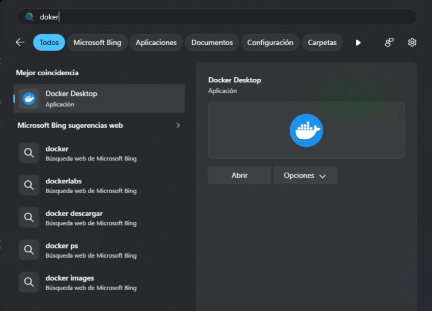
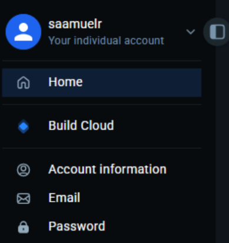
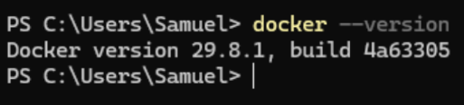
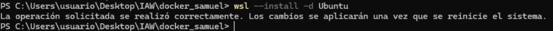
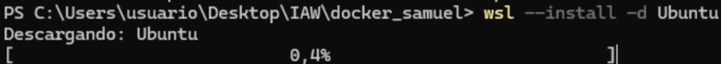
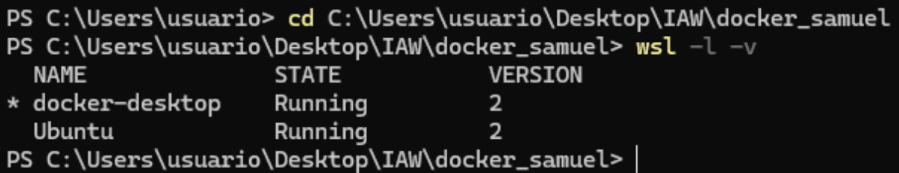
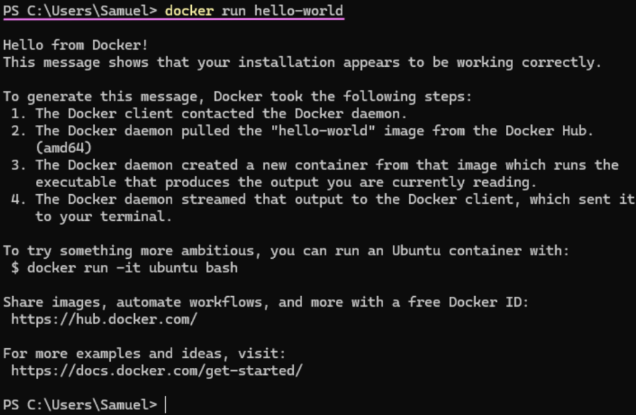

# 01_Introduccion_a_Docker

## Primero me instalo el docker   

## Y me creo una cuenta   

## Y compruebo que está instalado   

## Ahora instalo el WSL   

##  listo los dockers que están corriendo en este momento   

## Aquí veo que puedo iniciar sesión con Ubuntu   

## Una vez instalado, descargo Ubuntu para usarlo con el WSL   

## Y ejecuto el comando docker run hello-world y como se ve funciona correctamente   

