# 2º GSI – Bezmiliana EJECUTANDO Y GESTIONANDO CONTENEDORES

## 19 de octubre del 2026

## Samuel Rivas Fernández

## **Descarga de imagenes**

## Primero instalo las imágenes de ubuntu, debian, mariadb, mysql y httpd

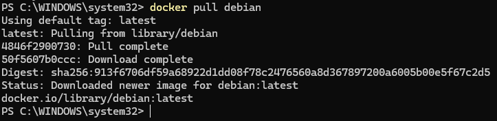
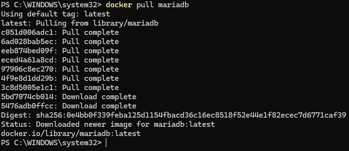
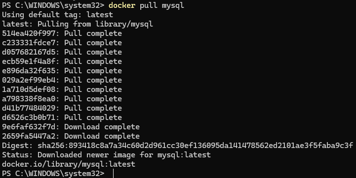

## Y estas son las imágenes descargadas

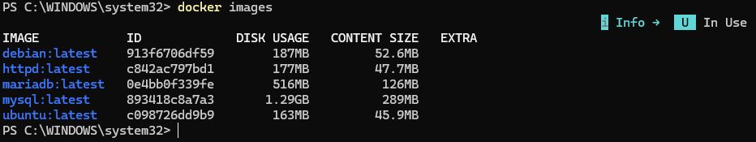

## **Arranca un contenedor**

## Creo el contenedor y arranco el ubuntu

## Salgo del ubuntu

## Y muestro que me he salido

## Arranco de nuevo el contenedor

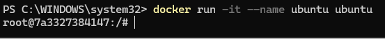

## Y en otra terminal muestro los contenedores activos

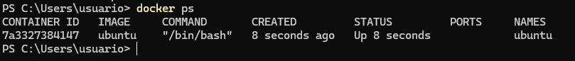

## Muestro el fichero /etc/os-release sin meterme a la máquina 

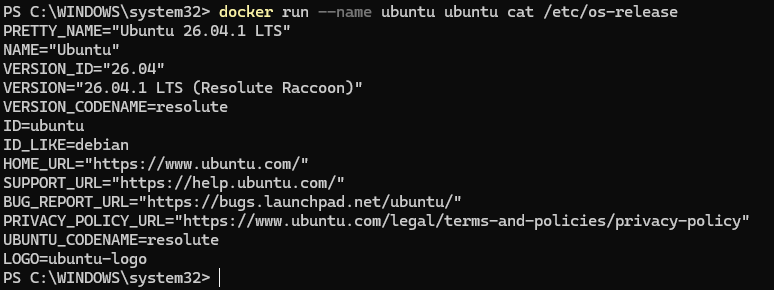

## **Ejecutar servicios desde contenedores**

## Arrancar el contenedor de php-apache que se llame web y que sea accesible desde el puerto 8181

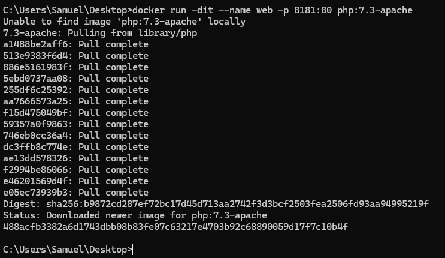
## docker  ps compruebo si el contenedor está activo

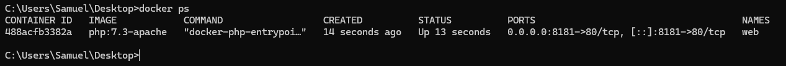

## Creo el index.html

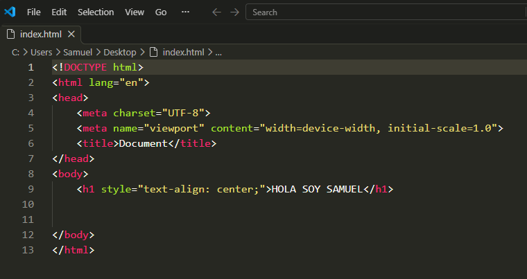

## Ahora copio el index.html

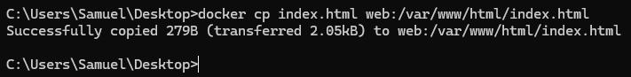

## Creo el PHP

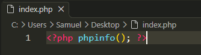

## Y subo el php también

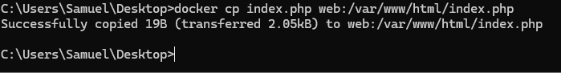

## Y aqui se ve como se puede ver la web desde el navegador

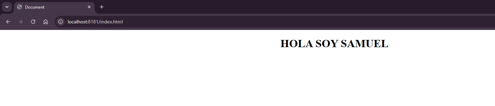
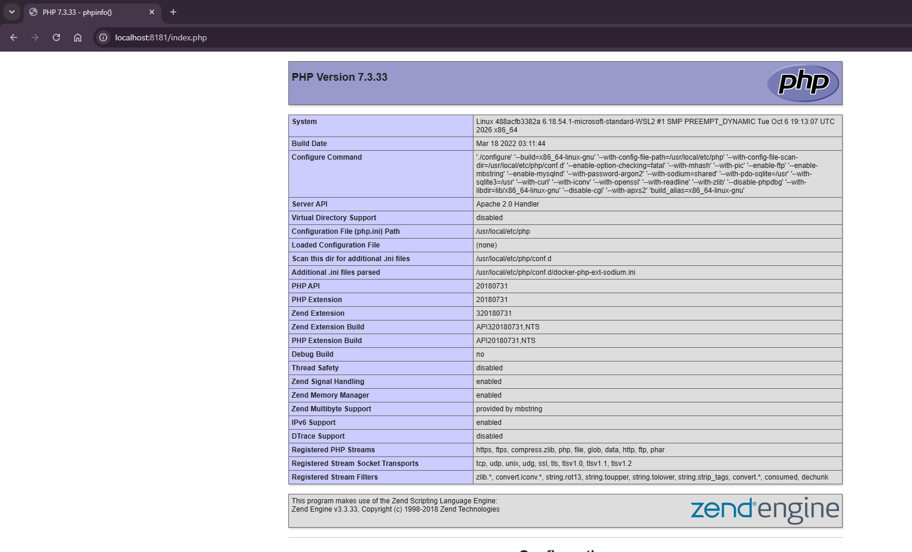

## Ahora instalo la base de datos

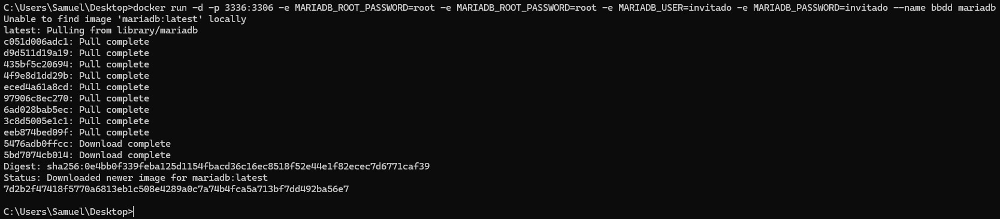
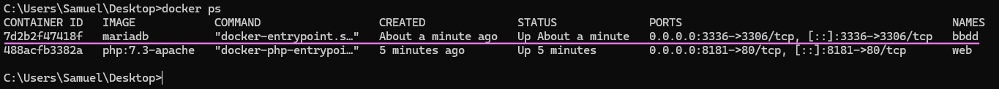

## Y la base de datos funciona perfectamente

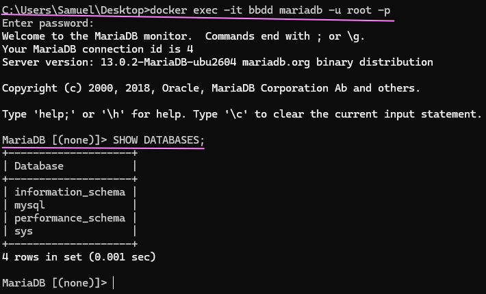

## **Obtener información de los contenedores**

## Compruebo la IP del contenedor web

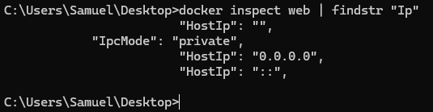

## Y compruebo el puerto del contenedor web

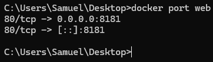

## Compruebo la IP de la base de datos

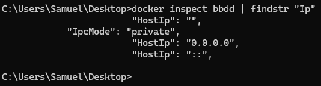

## Y su puerto

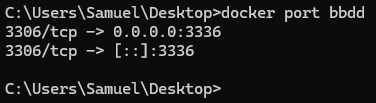
