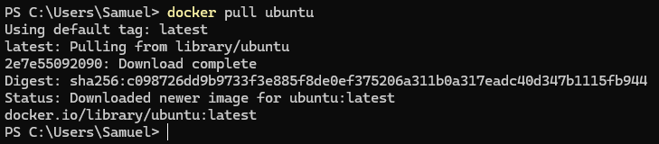
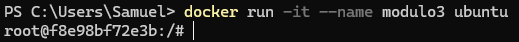
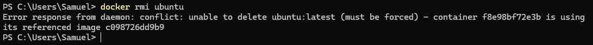
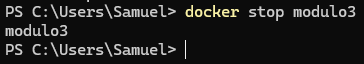
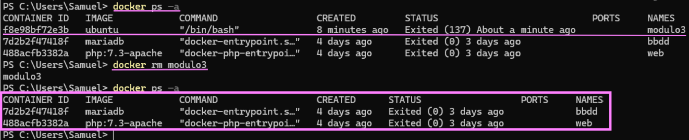
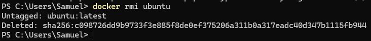

# 2º GSI – Bezmiliana

#  DESCARGA, INSPECCIONA Y BORRA IMÁGENES

## 23 de octubre del 2026

## Samuel Rivas Fernández

## Instalo la imagen del ubuntu

## Le vuelco el contenido al info.txt

## Ahora creo el contenedor del ubuntu

## No me deja borrar la imágen ya que se está usando en un contenedor

## Para poder borrar la imagen primero debo de parar el contenedor

## Como se puede ver el contenedor estaba parado pero aún existia así que lo elimino

## Y ya se puede eliminar la imágen

